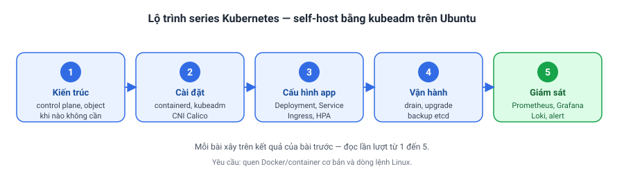

# Kubernetes

Kubernetes (K8s) là nền tảng orchestration container phổ biến nhất hiện nay — tự động hoá việc deploy, scale và vận hành ứng dụng container trên nhiều node.

Series này đi theo hướng **self-host bằng kubeadm trên Ubuntu 22.04/24.04** (không dùng managed service như EKS/GKE/AKS), phù hợp cho team muốn tự làm chủ hạ tầng on-premise hoặc VPS.

## Lộ trình đọc

Đọc lần lượt từ bài 1 đến bài 5 — mỗi bài xây trên kết quả của bài trước:

<figure><figcaption>
Lộ trình 5 bước: từ kiến trúc đến giám sát production
</figcaption></figure>

| # | Bài viết | Nội dung |
| - | -------- | -------- |
| 1 | [Kubernetes là gì? Kiến trúc và các thành phần cốt lõi](kubernetes-la-gi-kien-truc-va-cac-thanh-phan-cot-loi.md) | Declarative model, control plane, worker node, object model, khi nào KHÔNG cần K8s |
| 2 | [Cài đặt cluster Kubernetes bằng kubeadm trên Ubuntu](cai-dat-cluster-kubernetes-bang-kubeadm-tren-ubuntu.md) | Chuẩn bị node, containerd, kubeadm init/join, CNI Calico |
| 3 | [Cấu hình ứng dụng trên Kubernetes: Deployment, Service, Ingress](cau-hinh-ung-dung-tren-kubernetes-deployment-service-ingress.md) | Namespace, Deployment, ConfigMap/Secret, Service, Ingress + TLS, HPA |
| 4 | [Vận hành cluster Kubernetes: Nâng cấp, Backup, Troubleshooting](van-hanh-cluster-kubernetes-nang-cap-backup-troubleshooting.md) | kubectl hàng ngày, drain node, upgrade kubeadm, backup etcd, bảng lỗi phổ biến |
| 5 | [Giám sát Kubernetes với Prometheus, Grafana và Loki](giam-sat-kubernetes-voi-prometheus-grafana-loki.md) | metrics-server, kube-prometheus-stack, Loki/Promtail, alert rules mẫu |


Yêu cầu trước khi bắt đầu: quen với Docker/container cơ bản và dòng lệnh Linux. Nếu chưa, xem nhánh [Docker](../docker/README.md) trước.


## Bài viết


[kubernetes-la-gi-kien-truc-va-cac-thanh-phan-cot-loi](kubernetes-la-gi-kien-truc-va-cac-thanh-phan-cot-loi.md)



[cai-dat-cluster-kubernetes-bang-kubeadm-tren-ubuntu](cai-dat-cluster-kubernetes-bang-kubeadm-tren-ubuntu.md)



[cau-hinh-ung-dung-tren-kubernetes-deployment-service-ingress](cau-hinh-ung-dung-tren-kubernetes-deployment-service-ingress.md)



[van-hanh-cluster-kubernetes-nang-cap-backup-troubleshooting](van-hanh-cluster-kubernetes-nang-cap-backup-troubleshooting.md)



[giam-sat-kubernetes-voi-prometheus-grafana-loki](giam-sat-kubernetes-voi-prometheus-grafana-loki.md)
