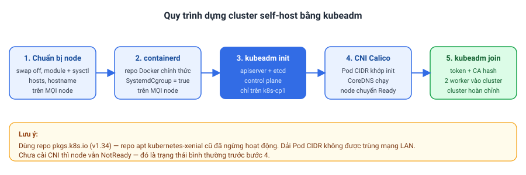

# Cài đặt cluster Kubernetes bằng kubeadm trên Ubuntu

Bài này hướng dẫn dựng một cluster Kubernetes self-host hoàn chỉnh bằng **kubeadm** trên Ubuntu: 1 control plane + 2 worker, container runtime containerd, CNI Calico. Đây là bài thực hành đầu tiên của series — nếu chưa nắm kiến trúc, đọc bài trước:


[kubernetes-la-gi-kien-truc-va-cac-thanh-phan-cot-loi](kubernetes-la-gi-kien-truc-va-cac-thanh-phan-cot-loi.md)


<figure><figcaption><p>5 bước dựng cluster: chuẩn bị node → containerd → kubeadm init → CNI Calico → kubeadm join</p></figcaption></figure>

## Yêu cầu

* **Hệ điều hành:** Ubuntu 22.04 hoặc 24.04 LTS, cài mới, đã update (`apt update && apt upgrade -y`).
* **Tài nguyên:** mỗi node tối thiểu **2 CPU / 2GB RAM** (control plane bắt buộc ≥ 2 CPU), disk ≥ 20GB.
* **Mạng:** các node thông nhau qua IP private, hostname duy nhất, MAC address và `product_uuid` không trùng (clone VM phải regenerate).
* **Quyền:** root hoặc sudo trên tất cả node.

### Quy hoạch node mẫu

| Hostname | Vai trò | IP mẫu | CPU/RAM tối thiểu |
| -------- | ------- | ------ | ----------------- |
| `k8s-cp1` | Control plane | `10.0.0.10` | 2 CPU / 2GB (khuyến nghị 4GB) |
| `k8s-w1` | Worker | `10.0.0.11` | 2 CPU / 2GB |
| `k8s-w2` | Worker | `10.0.0.12` | 2 CPU / 2GB |

Đặt hostname và khai báo `/etc/hosts` trên **tất cả node**:


```bash
# Trên control plane:
sudo hostnamectl set-hostname k8s-cp1
# Trên worker 1: sudo hostnamectl set-hostname k8s-w1
# Trên worker 2: sudo hostnamectl set-hostname k8s-w2

# Thêm vào /etc/hosts trên CẢ 3 node:
cat <<EOF | sudo tee -a /etc/hosts
10.0.0.10 k8s-cp1
10.0.0.11 k8s-w1
10.0.0.12 k8s-w2
EOF
```



Các bước dưới đây dùng version ví dụ: repo pkgs.k8s.io **v1.34**, Calico **v3.2x**. Khi làm thật, kiểm tra version stable mới nhất tại [kubernetes.io/releases](https://kubernetes.io/releases/) và [docs.tigera.io/calico](https://docs.tigera.io/calico/latest/getting-started/kubernetes/quickstart) rồi thay tương ứng. Lưu ý: repo apt `apt.kubernetes.io` (kubernetes-xenial) cũ **đã bị khai tử** — mọi hướng dẫn cũ dùng repo đó đều fail, phải dùng `pkgs.k8s.io`.


## Bước 1: Chuẩn bị chung (chạy trên TẤT CẢ node)

### 1.1. Tắt swap

kubelet mặc định không chạy khi swap bật:


```bash
sudo swapoff -a
sudo sed -i '/\sswap\s/s/^/#/' /etc/fstab
# Kiểm tra: cột Swap phải bằng 0
free -h
```


### 1.2. Kernel modules + sysctl

CNI cần `overlay`, `br_netfilter` và các tham số bridge/forward:


```bash
cat <<EOF | sudo tee /etc/modules-load.d/k8s.conf
overlay
br_netfilter
EOF

sudo modprobe overlay
sudo modprobe br_netfilter
```



```bash
cat <<EOF | sudo tee /etc/sysctl.d/k8s.conf
net.bridge.bridge-nf-call-iptables  = 1
net.bridge.bridge-nf-call-ip6tables = 1
net.ipv4.ip_forward                 = 1
EOF

sudo sysctl --system
# Verify:
sysctl net.bridge.bridge-nf-call-iptables net.ipv4.ip_forward
```


### 1.3. Cài containerd (từ repo Docker) + bật SystemdCgroup


```bash
sudo apt-get update
sudo apt-get install -y ca-certificates curl gnupg

sudo install -m 0755 -d /etc/apt/keyrings
curl -fsSL https://download.docker.com/linux/ubuntu/gpg | \
  sudo gpg --dearmor -o /etc/apt/keyrings/docker.gpg
sudo chmod a+r /etc/apt/keyrings/docker.gpg

echo "deb [arch=$(dpkg --print-architecture) signed-by=/etc/apt/keyrings/docker.gpg] \
https://download.docker.com/linux/ubuntu $(. /etc/os-release && echo "$VERSION_CODENAME") stable" | \
  sudo tee /etc/apt/sources.list.d/docker.list > /dev/null

sudo apt-get update
sudo apt-get install -y containerd.io
```


Sinh config mặc định rồi bật `SystemdCgroup = true` — bắt buộc để containerd dùng cùng cgroup driver (systemd) với kubelet:


```bash
sudo mkdir -p /etc/containerd
containerd config default | sudo tee /etc/containerd/config.toml > /dev/null

# Bật systemd cgroup driver
sudo sed -i 's/SystemdCgroup = false/SystemdCgroup = true/' /etc/containerd/config.toml

# Verify dòng cấu hình:
grep 'SystemdCgroup' /etc/containerd/config.toml

sudo systemctl restart containerd
sudo systemctl enable containerd
```



Nếu `SystemdCgroup` vẫn là `false`, kubelet sẽ khởi động nhưng Pod chết dần với lỗi cgroup driver mismatch — đây là lỗi cài đặt phổ biến nhất. Kiểm tra kỹ trước khi `kubeadm init`.


### 1.4. Cài kubelet, kubeadm, kubectl từ repo pkgs.k8s.io


```bash
sudo apt-get install -y apt-transport-https ca-certificates curl gpg

# Repo theo minor version — đổi v1.34 thành minor stable mới nhất khi cần
curl -fsSL https://pkgs.k8s.io/core:/stable:/v1.34/deb/Release.key | \
  sudo gpg --dearmor -o /etc/apt/keyrings/kubernetes-apt-keyring.gpg

echo 'deb [signed-by=/etc/apt/keyrings/kubernetes-apt-keyring.gpg] https://pkgs.k8s.io/core:/stable:/v1.34/deb/ /' | \
  sudo tee /etc/apt/sources.list.d/kubernetes.list

sudo apt-get update
sudo apt-get install -y kubelet kubeadm kubectl

# Giữ version, tránh apt upgrade tự nâng kubelet ngoài quy trình upgrade
sudo apt-mark hold kubelet kubeadm kubectl

sudo systemctl enable --now kubelet
```



Mỗi minor version của Kubernetes có một repo riêng (`v1.33`, `v1.34`, ...). Khi upgrade cluster lên minor mới, phải đổi URL repo — xem bài vận hành ở cuối series.


## Bước 2: Khởi tạo control plane (chỉ trên `k8s-cp1`)

Dùng `--pod-network-cidr=192.168.0.0/16` — dải mặc định Calico expects:


```bash
sudo kubeadm init \
  --apiserver-advertise-address=10.0.0.10 \
  --pod-network-cidr=192.168.0.0/16
```



Dải `192.168.0.0/16` không được trùng với mạng LAN/IP node của bạn (ví dụ mạng nhà hay dùng `192.168.1.x`). Nếu trùng, chọn dải khác (vd `10.244.0.0/16`) và cấu hình Calico tương ứng. Init lỗi giữa chừng: `sudo kubeadm reset` rồi làm lại.


Init thành công sẽ in ra lệnh `kubeadm join ... --token ... --discovery-token-ca-cert-hash sha256:...` — **lưu lại** để join worker.

### Copy kubeconfig cho user hiện tại


```bash
mkdir -p $HOME/.kube
sudo cp -i /etc/kubernetes/admin.conf $HOME/.kube/config
sudo chown $(id -u):$(id -g) $HOME/.kube/config

kubectl get nodes
# Lúc này control plane ở trạng thái NotReady — CHƯA cài CNI, hoàn toàn bình thường
```


## Bước 3: Cài CNI Calico (trên control plane)

Chưa có CNI thì node `NotReady` và CoreDNS `Pending`. Cài Calico bằng manifest:


```bash
kubectl create -f https://raw.githubusercontent.com/projectcalico/calico/v3.29.1/manifests/tigera-operator.yaml
kubectl create -f https://raw.githubusercontent.com/projectcalico/calico/v3.29.1/manifests/custom-resources.yaml
```


`custom-resources.yaml` mặc định khai báo `cidr: 192.168.0.0/16` — khớp với `--pod-network-cidr` ở Bước 2. Nếu bạn dùng dải khác, tải file về, sửa `cidr` rồi mới apply.


Thích Helm hơn? Có thể cài qua chart `tigera-operator` từ repo `https://docs.tigera.io/calico/charts`, cấu hình `installation.calicoNetwork.ipPools` tương ứng. Manifest ở trên là cách nhanh nhất cho cluster mới.


Chờ vài phút rồi kiểm tra:


```bash
kubectl get pods -n calico-system
kubectl get pods -n kube-system
kubectl get nodes
# k8s-cp1 phải chuyển sang Ready
```


## Bước 4: Join worker node (trên `k8s-w1`, `k8s-w2`)

Chạy lệnh join mà `kubeadm init` đã in ra:


```bash
sudo kubeadm join 10.0.0.10:6443 \
  --token <token> \
  --discovery-token-ca-cert-hash sha256:<hash>
```


Quên lưu lệnh join? Sinh lại trên control plane:


```bash
kubeadm token create --print-join-command
```


## Xác minh kết quả

Trên control plane:


```bash
kubectl get nodes -o wide
# NAME      STATUS   ROLES           AGE   VERSION
# k8s-cp1   Ready    control-plane   10m   v1.34.x
# k8s-w1    Ready    <none>          2m    v1.34.x
# k8s-w2    Ready    <none>          2m    v1.34.x

kubectl get pods -A
# Tất cả Pod: Running (calico-system, kube-system, tigera-operator)
```



Cả 3 node `Ready`, mọi Pod `Running` — cluster đã sẵn sàng nhận workload. Chuyển sang bài cấu hình ứng dụng.


## Các lỗi hay gặp

* **Swap chưa tắt:** `kubeadm init` báo `[ERROR Swap]: running with swap on is not supported` — chạy lại Bước 1.1, kể cả sửa `/etc/fstab` để không bật lại sau reboot.
* **Node NotReady mãi:** gần như luôn do chưa cài CNI hoặc CNI Pod lỗi. Kiểm tra `kubectl get pods -A` và `kubectl describe node <tên-node>` (mục Conditions: `NetworkPluginNotReady`).
* **Firewall chặn port:** control plane cần mở **6443** (apiserver), **2379–2380** (etcd), **10250** (kubelet), **10257/10259**; worker cần **10250**, **30000–32767** (NodePort). Calico dùng BGP port **179** hoặc VXLAN UDP **4789** giữa các node. Test nhanh: `nc -zv 10.0.0.10 6443` từ worker.
* **Token hết hạn (24h):** join báo lỗi token — dùng `kubeadm token create --print-join-command` để sinh lệnh mới.
* **Cgroup driver mismatch:** Pod khởi động rồi chết, kubelet log lỗi cgroup — kiểm tra lại `SystemdCgroup = true` (Bước 1.3).
* **Trùng Pod CIDR với mạng LAN:** Pod không thông mạng, DNS lỗi — reset cluster và init lại với dải khác.

## Bước tiếp theo


[cau-hinh-ung-dung-tren-kubernetes-deployment-service-ingress](cau-hinh-ung-dung-tren-kubernetes-deployment-service-ingress.md)


## Tài liệu tham khảo

* [Installing kubeadm — kubernetes.io](https://kubernetes.io/docs/setup/production-environment/tools/kubeadm/install-kubeadm/)
* [Creating a cluster with kubeadm — kubernetes.io](https://kubernetes.io/docs/setup/production-environment/tools/kubeadm/create-cluster-kubeadm/)
* [Container Runtimes: containerd — kubernetes.io](https://kubernetes.io/docs/setup/production-environment/container-runtimes/#containerd)
* [Calico Quickstart — docs.tigera.io](https://docs.tigera.io/calico/latest/getting-started/kubernetes/quickstart)
* [Install Docker Engine on Ubuntu (repo containerd) — docs.docker.com](https://docs.docker.com/engine/install/ubuntu/)