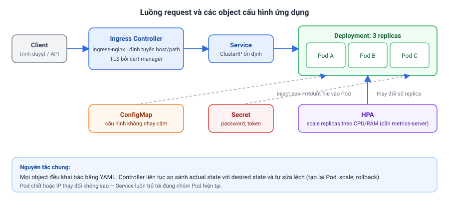

# Cấu hình ứng dụng trên Kubernetes: Deployment, Service, Ingress

Cluster đã chạy (xem bài cài đặt), giờ đưa ứng dụng lên đúng chuẩn: Namespace riêng, Deployment có probes và resources, cấu hình qua ConfigMap/Secret, expose bằng Service + Ingress có TLS, và autoscale bằng HPA. Ví dụ dùng image `nginx` làm app demo — thay bằng image của bạn, mọi khái niệm giữ nguyên.


[cai-dat-cluster-kubernetes-bang-kubeadm-tren-ubuntu](cai-dat-cluster-kubernetes-bang-kubeadm-tren-ubuntu.md)


<figure><figcaption><p>Luồng request Client → Ingress → Service → Pod và các object cấu hình đi kèm</p></figcaption></figure>

## Bước 1: Tạo Namespace

Namespace gom tài nguyên theo app/môi trường, tránh đặt tên lung tung trong `default`:


```yaml
apiVersion: v1
kind: Namespace
metadata:
  name: demo
```



```bash
kubectl apply -f namespace.yaml
# Từ đây mọi lệnh đều thêm -n demo
```


## Bước 2: ConfigMap + Secret

* **ConfigMap:** cấu hình không nhạy cảm — inject vào container qua env hoặc mount file.
* **Secret:** dữ liệu nhạy cảm (password, API key). Dùng `stringData` để viết plaintext trong YAML, K8s tự encode base64 khi lưu.


```yaml
apiVersion: v1
kind: ConfigMap
metadata:
  name: demo-config
  namespace: demo
data:
  APP_ENV: "production"
  APP_GREETING: "Hello from NQDEV"
---
apiVersion: v1
kind: Secret
metadata:
  name: demo-secret
  namespace: demo
type: Opaque
stringData:
  DB_PASSWORD: "doi-mat-khau-that-cua-ban"
```



Secret mặc định chỉ là base64, KHÔNG phải mã hoá. Đừng commit Secret chứa giá trị thật lên Git. Production: bật encryption at rest cho etcd, hoặc dùng External Secrets Operator / Sealed Secrets.



```bash
kubectl apply -f config.yaml
kubectl get configmap,secret -n demo
```


## Bước 3: Deployment

Deployment mẫu đầy đủ các thành phần nên có ở production:


```yaml
apiVersion: apps/v1
kind: Deployment
metadata:
  name: demo-web
  namespace: demo
  labels:
    app: demo-web
spec:
  replicas: 3
  selector:
    matchLabels:
      app: demo-web
  strategy:
    type: RollingUpdate
    rollingUpdate:
      maxSurge: 1
      maxUnavailable: 0
  template:
    metadata:
      labels:
        app: demo-web
    spec:
      containers:
        - name: web
          image: nginx:1.27-alpine
          ports:
            - containerPort: 80
          env:
            # Env đơn lẻ từ ConfigMap
            - name: APP_ENV
              valueFrom:
                configMapKeyRef:
                  name: demo-config
                  key: APP_ENV
            # Env đơn lẻ từ Secret
            - name: DB_PASSWORD
              valueFrom:
                secretKeyRef:
                  name: demo-secret
                  key: DB_PASSWORD
          # Nạp toàn bộ key của ConfigMap thành env (tuỳ chọn)
          envFrom:
            - configMapRef:
                name: demo-config
          resources:
            requests:
              cpu: "100m"
              memory: "128Mi"
            limits:
              cpu: "500m"
              memory: "256Mi"
          startupProbe:
            httpGet:
              path: /
              port: 80
            failureThreshold: 30
            periodSeconds: 5
          readinessProbe:
            httpGet:
              path: /
              port: 80
            initialDelaySeconds: 5
            periodSeconds: 10
          livenessProbe:
            httpGet:
              path: /
              port: 80
            initialDelaySeconds: 15
            periodSeconds: 20
```


Giải thích nhanh các khối quan trọng:

* **replicas:** số Pod mong muốn — ReplicaSet giữ đúng số này.
* **resources.requests:** lượng tài nguyên scheduler dùng để xếp Pod vào node. **limits:** trần cứng — vượt memory limit là bị OOMKilled, vượt CPU limit bị throttle.
* **startupProbe:** cho app khởi động chậm (tối đa 30 × 5s = 150s). Startup chưa xong thì liveness/readiness chưa chạy — tránh bị kill oan lúc boot.
* **readinessProbe:** fail thì Pod bị rút khỏi Service (không nhận traffic) nhưng KHÔNG bị restart.
* **livenessProbe:** fail thì kubelet restart container — dùng để chữa deadlock/treo.


**Requests/limits và OOMKilled:** đặt memory limit thấp hơn mức app thực dùng, Pod sẽ bị kill liên tục với trạng thái `OOMKilled` (exit code 137) rồi CrashLoopBackOff. Ngược lại, không đặt requests thì scheduler xếp node quá tải và Pod dễ bị Evicted. Nguyên tắc: đo mức dùng thực tế (`kubectl top pod`), đặt requests ≈ mức trung bình, limits ≈ đỉnh + dự phòng 20–30%.



```bash
kubectl apply -f deployment.yaml
kubectl rollout status deployment/demo-web -n demo
kubectl get pods -n demo -o wide
kubectl describe deployment demo-web -n demo
```


## Bước 4: Service — chọn loại phù hợp

Service tạo endpoint ổn định (DNS `<tên-service>.<namespace>.svc.cluster.local`) trước nhóm Pod có IP thay đổi liên tục. Ba loại chính:



**Mặc định.** Chỉ truy cập được TỪ BÊN TRONG cluster. Dùng cho mọi service nội bộ: app gọi API, app gọi database, frontend gọi backend.


```yaml
apiVersion: v1
kind: Service
metadata:
  name: demo-web
  namespace: demo
spec:
  type: ClusterIP
  selector:
    app: demo-web
  ports:
    - port: 80
      targetPort: 80
```


**Khi nào dùng:** app chỉ cần nói chuyện nội bộ, traffic từ ngoài đi qua Ingress. Đây là lựa chọn cho bài này — Ingress ở Bước 5 sẽ đứng trước Service này.


Mở một port tĩnh (**30000–32767**) trên MỌI node, forward vào Service. Truy cập từ ngoài qua `http://<IP-bất-kỳ-node>:<nodePort>`.


```yaml
apiVersion: v1
kind: Service
metadata:
  name: demo-web
  namespace: demo
spec:
  type: NodePort
  selector:
    app: demo-web
  ports:
    - port: 80
      targetPort: 80
      nodePort: 30080
```


**Khi nào dùng:** test nhanh, expose TCP/UDP không phải HTTP (Ingress không xử lý được), hoặc đứng sau một LB ngoài tự quản (HAProxy/NGINX trỏ vào nodePort). Nhược điểm: port xấu, không TLS, phải tự lo LB phía trước.


Yêu cầu một external load balancer cấp IP public cho Service. Trên cloud (EKS/GKE/AKS) đây là cách chuẩn. **Trên cluster self-host kubeadm, không có provider LB nên `EXTERNAL-IP` sẽ treo `<pending>` mãi** — trừ khi cài MetalLB.


```yaml
apiVersion: v1
kind: Service
metadata:
  name: demo-web
  namespace: demo
spec:
  type: LoadBalancer
  selector:
    app: demo-web
  ports:
    - port: 80
      targetPort: 80
```


**Khi nào dùng:** managed cloud, hoặc self-host có MetalLB cấp IP từ dải LAN. Mỗi Service LoadBalancer tốn một IP — nhiều app HTTP thì dùng 1 LB cho Ingress Controller rồi route bằng Ingress sẽ kinh tế hơn.



Bài này dùng ClusterIP:


```bash
kubectl apply -f service-clusterip.yaml
kubectl get svc -n demo

# Test từ trong cluster bằng Pod tạm:
kubectl run curl-test -n demo --rm -it --image=curlimages/curl --restart=Never -- \
  curl -s http://demo-web.demo.svc.cluster.local
```


## Bước 5: Ingress + TLS với ingress-nginx và cert-manager

Ingress route HTTP/HTTPS theo hostname/path vào Service. Cần 2 thành phần cài sẵn:

* **ingress-nginx:** Ingress Controller — thực sự nhận và route traffic.
* **cert-manager:** tự động xin/gia hạn chứng chỉ Let's Encrypt.


Cluster self-host không có LoadBalancer: cài ingress-nginx với `controller.service.type=NodePort` (đứng sau NGINX/HAProxy ngoài hoặc trỏ DNS thẳng vào node), hoặc cài MetalLB rồi dùng `LoadBalancer`. Ví dụ dưới dùng NodePort.


### 5.1. Cài ingress-nginx bằng Helm


```bash
helm repo add ingress-nginx https://kubernetes.github.io/ingress-nginx
helm repo update

helm install ingress-nginx ingress-nginx/ingress-nginx \
  --namespace ingress-nginx --create-namespace \
  --set controller.service.type=NodePort \
  --set controller.service.nodePorts.http=30080 \
  --set controller.service.nodePorts.https=30443

kubectl get pods -n ingress-nginx
```


### 5.2. Cài cert-manager + ClusterIssuer Let's Encrypt


```bash
helm repo add jetstack https://charts.jetstack.io
helm repo update

helm install cert-manager jetstack/cert-manager \
  --namespace cert-manager --create-namespace \
  --set crds.enabled=true

kubectl get pods -n cert-manager
```



```yaml
apiVersion: cert-manager.io/v1
kind: ClusterIssuer
metadata:
  name: letsencrypt-prod
spec:
  acme:
    server: https://acme-v02.api.letsencrypt.org/directory
    email: ban@example.com
    privateKeySecretRef:
      name: letsencrypt-prod-account-key
    solvers:
      - http01:
          ingress:
            ingressClassName: nginx
```



Let's Encrypt yêu cầu domain trỏ tới IP public của cluster và port 80 truy cập được từ Internet (HTTP-01 challenge). Trong mạng lab không có public IP: bỏ qua TLS hoặc dùng DNS-01 solver. Khi thử nghiệm, dùng server staging (`https://acme-staging-v02.api.letsencrypt.org/directory`) để tránh bị rate-limit.


### 5.3. Ingress với TLS


```yaml
apiVersion: networking.k8s.io/v1
kind: Ingress
metadata:
  name: demo-web
  namespace: demo
  annotations:
    cert-manager.io/cluster-issuer: letsencrypt-prod
spec:
  ingressClassName: nginx
  tls:
    - hosts:
        - demo.example.com
      secretName: demo-web-tls
  rules:
    - host: demo.example.com
      http:
        paths:
          - path: /
            pathType: Prefix
            backend:
              service:
                name: demo-web
                port:
                  number: 80
```



```bash
kubectl apply -f clusterissuer.yaml
kubectl apply -f ingress.yaml

kubectl get ingress -n demo
kubectl get certificate -n demo
# READY của certificate chuyển True sau 1-2 phút (Let's Encrypt xác thực)

kubectl describe certificate demo-web-tls -n demo
curl -I https://demo.example.com:30443   # self-host NodePort HTTPS
```


## Bước 6: HPA — tự động scale theo CPU

HorizontalPodAutoscaler tăng/giảm replicas theo metrics. **Điều kiện bắt buộc: cluster phải có metrics-server** (kubeadm không cài sẵn):


```bash
kubectl apply -f https://github.com/kubernetes-sigs/metrics-server/releases/latest/download/components.yaml

# Verify sau ~1 phút:
kubectl top nodes
```



Lab self-host với kubelet dùng self-signed cert, metrics-server có thể báo lỗi `x509: cannot validate certificate`. Cách chuẩn production là ký serving cert đúng; lab có thể patch thêm `--kubelet-insecure-tls` vào args của Deployment metrics-server (chỉ dùng cho lab). Chi tiết xem bài giám sát ở cuối series.



```yaml
apiVersion: autoscaling/v2
kind: HorizontalPodAutoscaler
metadata:
  name: demo-web
  namespace: demo
spec:
  scaleTargetRef:
    apiVersion: apps/v1
    kind: Deployment
    name: demo-web
  minReplicas: 3
  maxReplicas: 10
  metrics:
    - type: Resource
      resource:
        name: cpu
        target:
          type: Utilization
          averageUtilization: 70
```



HPA tính % CPU dựa trên **requests**, không phải limits. Deployment không khai báo `resources.requests.cpu` thì HPA không hoạt động (`<unknown>/70%`). Đây là lý do mọi container đều nên có requests.



```bash
kubectl apply -f hpa.yaml
kubectl get hpa -n demo
# TARGETS hiển thị dạng 12%/70% là metrics-server đang hoạt động đúng
```


## Xác minh toàn bộ


```bash
kubectl get all,hpa,ingress,certificate -n demo
kubectl get events -n demo --sort-by=.lastTimestamp | tail -20
```


Kết quả mong đợi: 3+ Pod `Running` và `READY 1/1`, Service ClusterIP có endpoint, Ingress có ADDRESS, Certificate `READY=True`, HPA có chỉ số TARGETS.

## Bước tiếp theo

App đã chạy — học cách vận hành cluster đường dài:


[van-hanh-cluster-kubernetes-nang-cap-backup-troubleshooting](van-hanh-cluster-kubernetes-nang-cap-backup-troubleshooting.md)


## Tài liệu tham khảo

* [Deployments — kubernetes.io](https://kubernetes.io/docs/concepts/workloads/controllers/deployment/)
* [Configure Probes — kubernetes.io](https://kubernetes.io/docs/tasks/configure-pod-container/configure-liveness-readiness-startup-probes/)
* [Service — kubernetes.io](https://kubernetes.io/docs/concepts/services-networking/service/)
* [Ingress — kubernetes.io](https://kubernetes.io/docs/concepts/services-networking/ingress/)
* [ingress-nginx — kubernetes.github.io](https://kubernetes.github.io/ingress-nginx/)
* [cert-manager — cert-manager.io](https://cert-manager.io/docs/)
* [HorizontalPodAutoscaler — kubernetes.io](https://kubernetes.io/docs/tasks/run-application/horizontal-pod-autoscale/)