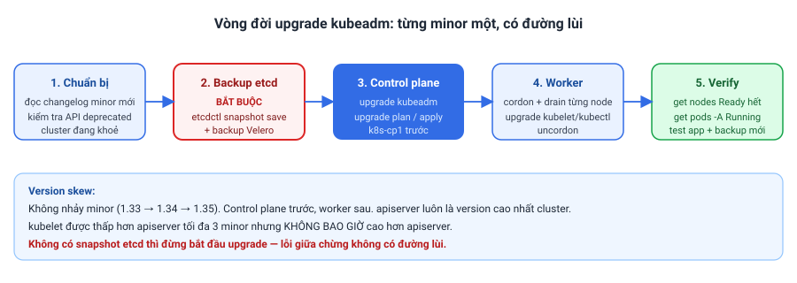

# Vận hành cluster Kubernetes: Nâng cấp, Backup, Troubleshooting

Dựng được cluster mới là 20% công việc — 80% còn lại là vận hành: debug app, bảo trì node, upgrade version, backup etcd. Bài này tổng hợp quy trình và bộ lệnh dùng hàng ngày cho cluster self-host kubeadm.

<figure><figcaption><p>Quy trình upgrade chuẩn: backup etcd trước, control plane trước worker sau, từng minor một</p></figcaption></figure>

## Bộ lệnh kubectl hàng ngày




```bash
kubectl get nodes -o wide                 # node + IP + version
kubectl get pods -A                       # mọi Pod, mọi namespace
kubectl get pods -n demo -o wide          # Pod trong namespace demo
kubectl get all -n demo                   # tổng quan workload + service
kubectl get events -n demo --sort-by=.lastTimestamp   # sự kiện gần nhất

kubectl describe pod <pod> -n demo        # chi tiết + Events (nguồn chẩn đoán số 1)
kubectl describe node k8s-w1              # conditions, tài nguyên, Pod đang chạy
```




```bash
kubectl logs <pod> -n demo                # log container
kubectl logs <pod> -n demo -c <container> # Pod nhiều container: chỉ định container
kubectl logs <pod> -n demo --previous     # log của lần chạy TRƯỚC (sau crash)
kubectl logs -f deploy/demo-web -n demo   # follow log của Deployment

kubectl exec -it <pod> -n demo -- sh      # shell vào container
kubectl top nodes                         # CPU/RAM node (cần metrics-server)
kubectl top pods -n demo                  # CPU/RAM từng Pod

# Pod tạm để debug mạng/DNS:
kubectl run netshoot -n demo --rm -it --image=nicolaka/netshoot --restart=Never -- bash
```




```bash
kubectl apply -f deployment.yaml                    # cập nhật khai báo
kubectl rollout status deploy/demo-web -n demo      # theo dõi rolling update
kubectl rollout history deploy/demo-web -n demo     # lịch sử revision
kubectl rollout undo deploy/demo-web -n demo        # rollback revision trước
kubectl rollout undo deploy/demo-web -n demo --to-revision=2
kubectl rollout restart deploy/demo-web -n demo     # restart toàn bộ Pod (đọc lại ConfigMap/Secret mount)

kubectl scale deploy/demo-web -n demo --replicas=5  # scale tay (HPA sẽ ghi đè nếu bật)
kubectl delete pod <pod> -n demo                    # xoá Pod — ReplicaSet tự tạo lại
```





Mẹo: đặt alias `alias k=kubectl` và bật completion (`source <(kubectl completion bash)`) — tiết kiệm hàng nghìn ký tự mỗi ngày.


## Bảo trì node: cordon / drain / uncordon

Quy trình chuẩn trước khi reboot, thay disk, hay upgrade một node:

1. **cordon:** đánh dấu node không nhận Pod mới.
2. **drain:** đuổi toàn bộ Pod hiện tại sang node khác (evict có kiểm soát, tôn trọng PodDisruptionBudget).
3. Bảo trì xong thì **uncordon** để node nhận Pod trở lại.


```bash
# 1. Chặn Pod mới
kubectl cordon k8s-w1

# 2. Đuổi Pod sang node khác
#    --ignore-daemonsets: bỏ qua DaemonSet (không thể evict)
#    --delete-emptydir-data: chấp nhận mất dữ liệu emptyDir
kubectl drain k8s-w1 --ignore-daemonsets --delete-emptydir-data

# 3. Bảo trì: reboot / thay phần cứng / upgrade...
sudo reboot

# 4. Node khoẻ lại -> mở lại scheduling
kubectl uncordon k8s-w1
kubectl get nodes
```



Drain node chạy Pod dùng `emptyDir` sẽ mất dữ liệu tạm trong đó — flag `--delete-emptydir-data` là xác nhận bạn chấp nhận. App quan trọng phải có ≥ 2 replicas + PodDisruptionBudget để drain không gây downtime. Node duy nhất chạy StatefulSet gắn local storage thì không drain được — phải xử lý storage trước.


## Upgrade cluster kubeadm

### Version skew policy — quy tắc bắt buộc

* **Từng minor một:** 1.33 → 1.34 → 1.35, KHÔNG nhảy cóc (1.33 → 1.35 không được hỗ trợ).
* **Control plane trước, worker sau:** apiserver là version cao nhất cluster; kubelet được phép thấp hơn apiserver tối đa 3 minor nhưng không bao giờ cao hơn.
* **kubeadm cùng version với đích upgrade:** nâng kubeadm trước, dùng nó upgrade control plane, rồi mới nâng kubelet/kubectl.
* **Đọc changelog trước:** mỗi minor có thể có API bị remove, action required — xem [CHANGELOG](https://github.com/kubernetes/kubernetes/blob/master/CHANGELOG/).


**Backup etcd là BẮT BUỘC trước mọi lần upgrade.** Upgrade lỗi giữa chừng có thể hỏng control plane; không có snapshot etcd thì không có đường lùi. Làm mục Backup etcd bên dưới TRƯỚC khi chạy bất kỳ lệnh upgrade nào.


### Bước 1: Upgrade control plane đầu tiên (`k8s-cp1`)


```bash
# Đổi repo apt sang minor mới
sudo sed -i 's/v1\.34/v1.35/g' /etc/apt/sources.list.d/kubernetes.list
sudo apt-get update

# Nâng kubeadm
sudo apt-mark unhold kubeadm
sudo apt-get install -y kubeadm
sudo apt-mark hold kubeadm
kubeadm version
```



```bash
# Xem trước thay đổi, kiểm tra cluster đủ điều kiện upgrade
sudo kubeadm upgrade plan

# Apply (trên node control plane ĐẦU TIÊN)
sudo kubeadm upgrade apply v1.35.0
```



```bash
# Drain chính node này trước (chạy từ máy có kubectl)
kubectl drain k8s-cp1 --ignore-daemonsets

sudo apt-mark unhold kubelet kubectl
sudo apt-get install -y kubelet kubectl
sudo apt-mark hold kubelet kubectl

sudo systemctl daemon-reload
sudo systemctl restart kubelet

kubectl uncordon k8s-cp1
```



Nếu có nhiều control plane node (HA): node thứ hai trở đi dùng `sudo kubeadm upgrade node` thay vì `upgrade apply`, và không cần chạy `upgrade plan` lại.


### Bước 2: Upgrade từng worker (tuần tự, không làm song song)

Trên mỗi worker (`k8s-w1`, rồi `k8s-w2`):


```bash
# --- Trên control plane: drain worker trước ---
kubectl drain k8s-w1 --ignore-daemonsets --delete-emptydir-data

# --- Trên worker k8s-w1: ---
sudo sed -i 's/v1\.34/v1.35/g' /etc/apt/sources.list.d/kubernetes.list
sudo apt-get update
sudo apt-mark unhold kubeadm
sudo apt-get install -y kubeadm
sudo apt-mark hold kubeadm

# Nâng cấu hình kubelet cho version mới
sudo kubeadm upgrade node

sudo apt-mark unhold kubelet kubectl
sudo apt-get install -y kubelet kubectl
sudo apt-mark hold kubelet kubectl
sudo systemctl daemon-reload
sudo systemctl restart kubelet

# --- Trên control plane: mở lại node ---
kubectl uncordon k8s-w1
```



```bash
kubectl get nodes
# Cột VERSION của mọi node phải là v1.35.x, STATUS Ready
kubectl get pods -A | grep -v Running
```


## Backup etcd

etcd chứa toàn bộ trạng thái cluster. Snapshot định kỳ + snapshot trước upgrade là bắt buộc.

### Snapshot save

Chạy trên control plane, dùng cert có sẵn của kubeadm:


```bash
# Cài etcdctl (chứa trong package etcd-client trên Ubuntu)
sudo apt-get install -y etcd-client

sudo ETCDCTL_API=3 etcdctl snapshot save /backup/etcd-$(date +%F-%H%M).db \
  --endpoints=https://127.0.0.1:2379 \
  --cacert=/etc/kubernetes/pki/etcd/ca.crt \
  --cert=/etc/kubernetes/pki/etcd/server.crt \
  --key=/etc/kubernetes/pki/etcd/server.key

# Verify snapshot
sudo ETCDCTL_API=3 etcdctl snapshot status /backup/etcd-$(date +%F-%H%M).db --write-table
```



Đưa snapshot ra khỏi node (rsync/object storage) và đặt cron backup hàng ngày. Snapshot chỉ có giá trị khi nằm ở nơi khác và được thử restore định kỳ. Backup cả thư mục `/etc/kubernetes/pki` — restore etcd cần lại bộ cert cũ.


### Snapshot restore


```bash
# 1. Dừng control plane tĩnh bằng cách dời manifest ra ngoài
sudo mv /etc/kubernetes/manifests /etc/kubernetes/manifests.bak
# kubelet sẽ tự dừng các Pod apiserver/etcd/scheduler/controller-manager

# 2. Restore snapshot vào thư mục data MỚI
sudo ETCDCTL_API=3 etcdctl snapshot restore /backup/etcd-2026-01-01-0200.db \
  --data-dir=/var/lib/etcd-restore

# 3. Trỏ etcd vào data mới: sửa volumes hostPath trong
#    /etc/kubernetes/manifests.bak/etcd.yaml: /var/lib/etcd -> /var/lib/etcd-restore

# 4. Đưa manifest về chỗ cũ để control plane khởi động lại
sudo mv /etc/kubernetes/manifests.bak /etc/kubernetes/manifests

# 5. Verify
kubectl get nodes
kubectl get pods -A
```


### Backup tài nguyên + PV: Velero

Snapshot etcd cứu control plane, nhưng không tiện cho nhu cầu "restore 1 namespace bị xoá nhầm" hay backup dữ liệu trong volume. Dùng **Velero**:

* **Backup tài nguyên:** Velero snapshot object YAML theo namespace/label, lưu lên S3-compatible storage (MinIO, AWS S3...).
* **Backup PV:** tích hợp CSI snapshot hoặc file-level backup (node-agent) cho dữ liệu trong PersistentVolume.
* **Restore chọn lọc:** khôi phục từng namespace/app thay vì cả cluster như etcd restore.


```bash
# Cài velero CLI từ GitHub release, rồi (ví dụ với MinIO làm storage):
velero install \
  --provider aws \
  --plugins velero/velero-plugin-for-aws:v1.11.0 \
  --bucket velero-backup \
  --secret-file ./credentials-minio \
  --backup-location-config region=minio,s3ForcePathStyle=true,s3Url=http://minio.example.com:9000

# Backup namespace demo
velero backup create demo-backup --include-namespaces demo

# Restore
velero restore create --from-backup demo-backup
```


## Troubleshooting: bảng lỗi phổ biến

| Hiện tượng | Nguyên nhân thường gặp | Lệnh chẩn đoán | Cách xử lý |
| ---------- | ---------------------- | -------------- | ---------- |
| **CrashLoopBackOff** | App crash lúc start: sai config/env, thiếu dependency, lỗi code, probe sai | `kubectl logs <pod> --previous`, `kubectl describe pod <pod>` | Đọc log lần chạy trước, sửa config/code; kiểm tra livenessProbe không kill app lúc boot (thêm startupProbe) |
| **ImagePullBackOff / ErrImagePull** | Sai tên image/tag, registry private thiếu credentials, mạng chặn registry | `kubectl describe pod <pod>` (mục Events) | Sửa đúng image:tag; tạo `imagePullSecrets` cho registry private; kiểm tra node ra được Internet |
| **Pending** | Thiếu CPU/RAM khả dụng, chưa có PVC bound, nodeSelector/affinity/taint không khớp | `kubectl describe pod <pod>` (Events: FailedScheduling), `kubectl describe node` | Thêm node/giảm requests; kiểm tra PVC và StorageClass; sửa selector/toleration |
| **OOMKilled** (exit 137) | Container vượt memory limit, hoặc memory leak | `kubectl describe pod <pod>` (Last State), `kubectl top pod` | Tăng memory limit theo mức dùng thực; tìm memory leak trong app |
| **Evicted** | Node hết disk/memory (DiskPressure/MemoryPressure), kubelet đuổi Pod | `kubectl describe node <node>` (Conditions), `df -h` trên node | Dọn disk (image cũ: `crictl rmi --prune`), dọn log; xoá Pod Evicted: `kubectl delete pod <pod>`; tăng tài nguyên node |
| **Node NotReady** | kubelet chết, containerd chết, CNI lỗi, mất mạng tới apiserver | `kubectl describe node <node>`, trên node: `systemctl status kubelet containerd`, `journalctl -u kubelet -f` | Restart kubelet/containerd; kiểm tra CNI Pod; kiểm tra mạng/port 6443–10250; xem lại swap đã tắt chưa |
| **ContainerCreating treo** | CNI chưa cấp IP, mount volume lỗi, image pull chậm | `kubectl describe pod <pod>` (Events) | Kiểm tra CNI PodRunning; kiểm tra PVC/volume; chờ hoặc đổi registry mirror |
| **Service không thông** | Selector không khớp label Pod, readiness fail nên không có endpoint | `kubectl get endpoints <svc> -n demo`, `kubectl get pods --show-labels` | Sửa selector khớp label; sửa readinessProbe; test DNS bằng Pod netshoot |

Quy trình debug chuẩn: `get pods` thấy trạng thái lạ → `describe pod` đọc Events → `logs` (kèm `--previous` nếu crash) → `exec` vào trong nếu cần → kiểm tra tầng node (`describe node`, `journalctl -u kubelet`).

## Bước tiếp theo

Vận hành tốt cần nhìn thấy bên trong cluster — dựng monitoring:


[giam-sat-kubernetes-voi-prometheus-grafana-loki](giam-sat-kubernetes-voi-prometheus-grafana-loki.md)


## Tài liệu tham khảo

* [kubectl Cheat Sheet — kubernetes.io](https://kubernetes.io/docs/reference/kubectl/quick-reference/)
* [Safely Drain a Node — kubernetes.io](https://kubernetes.io/docs/tasks/administer-cluster/safely-drain-node/)
* [Upgrading kubeadm clusters — kubernetes.io](https://kubernetes.io/docs/tasks/administer-cluster/kubeadm/kubeadm-upgrade/)
* [Version Skew Policy — kubernetes.io](https://kubernetes.io/releases/version-skew-policy/)
* [Backing up an etcd cluster — kubernetes.io](https://kubernetes.io/docs/tasks/administer-cluster/configure-upgrade-etcd/#backing-up-an-etcd-cluster)
* [Velero Documentation — velero.io](https://velero.io/docs/)
* [Debug Pods — kubernetes.io](https://kubernetes.io/docs/tasks/debug/debug-application/debug-pods/)